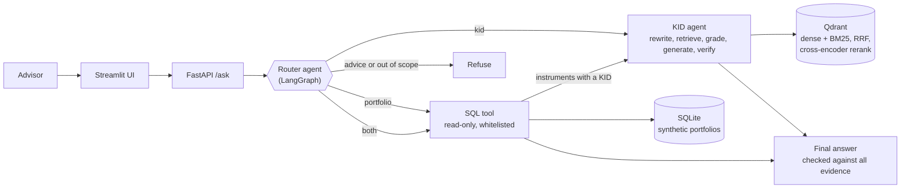

# WealthAI-Copilot

[](https://github.com/Naimket/wealthai-copilot/actions/workflows/ci.yml)

A multi-source RAG agent that helps wealth advisors answer factual questions from **fund Key Information Documents (KIDs)**
and from **client portfolio data**, without inventing facts and without giving investment advice.

Built with LangGraph, hybrid retrieval with a cross-encoder reranker, Ragas evaluation, a read-only SQL tool and a
FastAPI + Streamlit front-end. It runs locally on a laptop (no GPU) against the Gemini free tier.

> **Status:** working end to end on a 5-fund KID library and 25 synthetic clients. The numbers below come from a
> development set; a blind test set and macro-report sources are the next steps (see [Roadmap](#roadmap)).

## What it does

| Question | Route | What happens |
|---|---|---|
| "What are the ongoing costs of the Vanguard FTSE All-World UCITS ETF?" | KIDs | Retrieve, grade, generate, verify against the passages |
| "How many clients do we have per risk profile?" | Portfolios | The LLM writes SQL, a read-only tool runs it, the answer is verified against the rows |
| "Which funds does Alice Brunner hold and what are their ongoing costs?" | Both | SQL first, then a self-contained KID question for the instruments that have a KID; instruments without one are reported as such |
| "Should I sell Alice Brunner's Vanguard position?" | Refused | A rule-based guard refuses before any LLM call |
| "What is the weather in Nyon?" | Out of scope | Politely declined |

Every answer returns its evidence (retrieved passages, executed SQL, decision trace), so it can be audited.

## Architecture



Detailed graphs, generated from the compiled LangGraph objects:
[KID agent](docs/agent_graph.md) | [multi-source router](docs/multi_agent_graph.md).

### Design decisions

- **Two agents, one wrapped by the other.** The KID agent was evaluated first and left untouched; the router calls it
  as a node. Adding portfolios did not require re-validating the document pipeline.
- **Control flow is decided by typed fields, not by parsing text.** Every LLM node returns a small Pydantic object
  (`Grade`, `Verification`, `Route`, `SqlQuery`, ...), so routing never depends on free-text wording.
- **Abstaining is a feature.** The grader detects "this is not in the documents" and the agent says so; a final
  verification step re-checks every number against the evidence and regenerates once before giving up.
- **The LLM never touches the database directly.** It writes a query; the tool decides whether it runs.
- **Provider-agnostic LLM layer.** All model calls go through `src/wealthai/llm.py` (structured output, retries,
  rate-limit throttling). Swapping Gemini for OpenAI, Anthropic, Bedrock or Vertex means changing that one module.

## Results (development set, 55 questions)

Questions: factual, comparative, hard (paraphrases, synonyms, cross-document), and unanswerable, over 5 KIDs
(83 chunks). LLM: Gemini flash-lite (free tier).

**Retrieval ablation** (35 single-document questions, k=5, no LLM calls):

| Retrieval | hit@5 | MRR |
|---|---|---|
| Dense (baseline) | 85.7% | 0.764 |
| BM25 | 82.9% | 0.779 |
| Hybrid (dense + BM25, RRF) | 91.4% | 0.818 |
| Any of the three + cross-encoder rerank | 100% | 0.986 |

**End to end:**

| System | Comparative | Hard (answer) | Abstentions | Faithfulness | Answer relevancy |
|---|---|---|---|---|---|
| Dense, single pass | 75% | 58% (11/19) | 12/12 | 0.977 | 0.920 |
| Hybrid + per-fund + rerank, single pass | 100% | 100% (19/19) | 12/12 | 0.995 | 0.927 |
| LangGraph agent | 100% | 100% (19/19) | 12/12 | pending | pending |

Faithfulness and answer relevancy are measured with [Ragas](https://docs.ragas.io). Ragas only scores questions that
were answered, so wrongful abstentions are tracked with deterministic checks against known KID values.

**Honest reading of these numbers**
- The 55 questions guided the design, so 100% is a development-set result, not a generalisation claim.
- On this set the agent ties the single-pass pipeline at about 4x the LLM calls and 8x the latency (~17 s vs ~2 s).
  Whether the extra machinery pays off is what the blind test set is for.
- The reranker is what moved retrieval; it ties across the three first-stage variants because the set is saturated.

Full tables, findings and caveats: [docs/results.md](docs/results.md).

## Safeguards for a regulated domain

- Rule-based advice guard runs before any LLM call; an LLM router adds a second check for suitability questions.
- Answers must be supported by retrieved passages or SQL rows; unsupported drafts are regenerated once, then withheld.
- The SQL tool opens the database read-only, allows only `SELECT` on three tables, whitelists functions, limits rows
  and runtime, and returns readable errors the agent can use to fix its query (32 tests, including injection attempts).
- All client data is synthetic and generated from a fixed seed. No real person or account is involved.
- Output is factual reporting only: no recommendations, no suitability assessment.

## Quickstart

Requires Python 3.12+ and [uv](https://docs.astral.sh/uv/). No GPU needed.

```powershell
uv sync --group ui
copy .env.example .env          # then put your Gemini API key (free from Google AI Studio) in .env
```

1. Download the KIDs of the five funds from the issuers' websites into `data/raw/` as
   `ishares_core_msci_em_imi.pdf`, `ishares_core_msci_world.pdf`, `ishares_core_s&p_500.pdf`,
   `vanguard_ftse_all_world.pdf` and `xtrackers_msci_world.pdf`.
2. Build the indexes and the synthetic portfolios:
   ```powershell
   uv run python scripts/ingest.py
   uv run python scripts/make_portfolios.py
   ```
3. Ask from the command line, or start the service and the UI (two terminals):
   ```powershell
   uv run python scripts/ask_multi.py "Which funds does Alice Brunner hold and what are their ongoing costs?"

   uv run uvicorn wealthai.api:app --app-dir src
   uv run --group ui streamlit run app/streamlit_app.py
   ```
   Interactive API docs: http://127.0.0.1:8000/docs
4. Tests (no API key, no models needed): `uv run pytest`

### Docker

After step 2 (the data is built locally and mounted, not baked into the images):

```powershell
docker compose up --build
```

UI on http://localhost:8501 and API docs on http://localhost:8000/docs. CI builds both images and checks that
the API answers on `/health`; the full question-answering path runs in the local setup above.

Reproduce the evaluation (uses the daily free-tier quota; see `docs/results.md`):

```powershell
uv run python scripts/eval_retrieval.py                  # retrieval ablation, no LLM
uv run python scripts/eval_naive.py --mode agent         # end-to-end on the 55 questions
uv run python scripts/eval_ragas.py data/eval/answers_agent.jsonl data/eval/ragas_agent.csv
```

## Repository layout

```
src/wealthai/
  ingestion/     PDF parsing (section-aware, two-column fix), chunking, indexing
  retrieval.py   dense, BM25, RRF, cross-encoder rerank, fund detection, per-fund balancing
  rag/           single-pass RAG baseline
  agent/         graph.py (KID agent), multi.py (router), guardrails.py
  tools/sql.py   read-only SQL tool with layered protections
  portfolio/     synthetic client portfolios
  llm.py         Gemini wrapper: structured output, retries, throttling
  api.py         FastAPI service
app/             Streamlit front-end (talks to the API only)
Dockerfile, docker-compose.yml, .github/workflows/ci.yml
scripts/         ingestion, evaluation, golden-set builders, CLI entry points
tests/           61 tests: SQL safety, router control flow, API, UI (no LLM calls)
data/golden/     the 55-question development set
docs/            results log and agent graphs
```

## Roadmap

- [ ] Blind test set (new questions, frozen before running) and repeated runs to report variance
- [ ] Ragas scores for the agent; agent vs single-pass with the same terminology glossary
- [ ] Macro-report source (central bank publications) and a `macro` route
- [ ] A test that feeds the verification step deliberately wrong answers
- [ ] Larger KID library, including Swiss-domiciled products
- [x] Dockerfile and docker-compose, built and smoke-tested in CI
- [ ] Deployment notes for AWS or GCP

## Limitations

Five funds and 25 synthetic clients keep the project reproducible, not representative. The free tier limits throughput,
so evaluations are rationed and the agent is slow by design (several sequential LLM calls). Results depend on the
chosen Gemini model; numbers are only comparable when produced with the same model.

## Author

Naim Ketfi, MSc student in Wealth Management (UNIGE GSEM), Switzerland. MIT licence.
