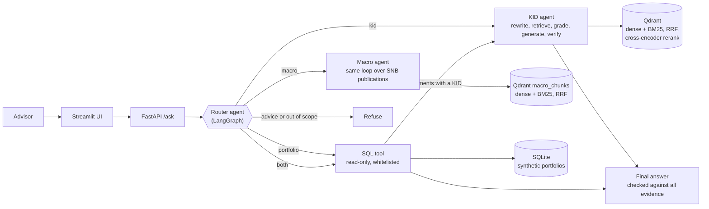

# WealthAI-Copilot

[](https://github.com/Naimket/wealthai-copilot/actions/workflows/ci.yml)

A multi-source RAG agent that helps wealth advisors answer factual questions from **fund Key Information Documents (KIDs)**,
**Swiss National Bank publications** and **client portfolio data**, without inventing facts and without giving investment
advice.

Built with LangGraph, hybrid retrieval with a cross-encoder reranker, Ragas evaluation, a read-only SQL tool and a
FastAPI + Streamlit front-end. It runs locally on a laptop (no GPU) against the Gemini free tier.

> **Status:** working end to end on a 5-fund KID library, two SNB publications and 25 synthetic clients. Numbers are
> reported with the set they come from (development, blind or held-out) and the model used; the remaining work is
> listed in the [Roadmap](#roadmap).

## What it does

| Question | Route | What happens |
|---|---|---|
| "What are the ongoing costs of the Vanguard FTSE All-World UCITS ETF?" | KIDs | Retrieve, grade, generate, verify against the passages |
| "What did the SNB decide on 24 September 2026, and what was CPI inflation in August?" | Macro (SNB) | A second agent with its own retrieval over the SNB monetary policy assessment and Quarterly Bulletin; same grade / generate / verify loop |
| "How many clients do we have per risk profile?" | Portfolios | The LLM writes SQL, a read-only tool runs it, the answer is verified against the rows |
| "Which funds does Alice Brunner hold and what are their ongoing costs?" | Both | SQL first, then a self-contained KID question for the instruments that have a KID; instruments without one are reported as such |
| "Which clients hold the fund with the lowest ongoing costs?" | KIDs first, then portfolios | The KID agent returns the cost of every fund, the model picks the qualifying funds (validated against the database in code), and SQL finds the clients holding them |
| "Should I sell Alice Brunner's Vanguard position?" | Refused | A rule-based guard refuses before any LLM call |
| "What is the weather in Nyon?" | Out of scope | Politely declined |

Every answer returns its evidence (retrieved passages, executed SQL, decision trace), so it can be audited.

## Architecture



Detailed graphs, generated from the compiled LangGraph objects:
[KID agent](docs/agent_graph.md) | [macro agent](docs/macro_agent_graph.md) | [multi-source router](docs/multi_agent_graph.md).

### Design decisions

- **Separate agents behind one router.** The KID agent was evaluated first and left untouched; the router calls it
  as a node, and the macro agent is a sibling with its own vocabulary, grading rules and retrieval. Adding portfolios
  or macro sources did not require re-validating the KID pipeline.
- **Control flow is decided by typed fields, not by parsing text.** Every LLM node returns a small Pydantic object
  (`Grade`, `Verification`, `Route`, `SqlQuery`, ...), so routing never depends on free-text wording.
- **Abstaining is a feature.** The grader detects "this is not in the documents" and the agent says so; a final
  verification step re-checks every number against the evidence and regenerates once before giving up.
- **The LLM never touches the database directly.** It writes a query; the tool decides whether it runs.
- **Provider-agnostic LLM layer.** All model calls go through `src/wealthai/llm.py` (structured output, retries,
  rate-limit throttling). Swapping Gemini for OpenAI, Anthropic, Bedrock or Vertex means changing that one module.

## Results (development set, 55 questions)

Questions: factual, comparative, hard (paraphrases, synonyms, cross-document), and unanswerable, over 5 KIDs
(83 chunks). LLM: Gemini flash-lite (free tier).

**Retrieval ablation** (35 single-document questions, k=5, no LLM calls):

| Retrieval | hit@5 | MRR |
|---|---|---|
| Dense (baseline) | 85.7% | 0.764 |
| BM25 | 82.9% | 0.779 |
| Hybrid (dense + BM25, RRF) | 91.4% | 0.818 |
| Any of the three + cross-encoder rerank | 100% | 0.986 |

**End to end:**

| System | Comparative | Hard (answer) | Abstentions | Faithfulness | Answer relevancy |
|---|---|---|---|---|---|
| Dense, single pass | 75% | 58% (11/19) | 12/12 | 0.977 | 0.920 |
| Hybrid + per-fund + rerank, single pass | 100% | 100% (19/19) | 12/12 | 0.995 | 0.927 |
| LangGraph agent | 100% | 100% (19/19) | 12/12 | 0.957 | 0.942 |

Faithfulness and answer relevancy are measured with [Ragas](https://docs.ragas.io). Ragas only scores questions that
were answered, so wrongful abstentions are tracked with deterministic checks against known KID values.

**Blind test set** (52 new questions, written from the KIDs and frozen in git before the first run; agent, model alias
`gemini-flash-lite-latest`, first run, no tuning):

| Question type | Answer correct |
|---|---|
| Factual (33) | 33/33 |
| Hard: French, paraphrase, loose names (5) | 5/5 |
| Unanswerable and advice traps (10) | 10/10 abstained or refused |
| Comparative / cross-document (4) | 1/4 |
| **Total** | **49/52** |

All three misses are cross-document questions: the query rewriter replaced "total costs" with "ongoing costs", and the
grader asked for every fund to appear on a "which KID is addressed to Switzerland" question. The prompts were then
changed, so these 52 questions are no longer blind for those cases (a re-run after the fixes scored 51/52: comparative 3/4, the
remaining miss is a safe abstention on a retrieval gap; a regression result, not a generalisation claim); a separate 14-question holdout checks the fix
([details](docs/results.md)). That holdout scored 13/14 on its first run; after a deterministic coverage fix for
"which fund ..." questions (designed on the one miss, h02), a fresh run with the current code scored **14/14** (h02 now
retrieves all five funds). In that run the verification step fired twice on real drafts (h05, h07), each time with a
specific reason, and the regenerated answers passed the checks; h02 is no longer a held-out case.

**Macro source: SNB publications of September 2026** (whole multi-source agent, deterministic checks; a question is
correct only if it was routed to `macro` and the answer contains the expected fact):

| Set | Model | Result |
|---|---|---|
| Held-out, 18 questions (14 answerable, 4 traps), first run | Gemini 3.1 Flash Lite | 17/18 |
| Same set after the one routing fix it exposed | `gemini-flash-lite-latest` | 18/18 |
| Development set, 52 questions, first run (original agent, corrected labels) | `gemini-flash-lite-latest` | 42/50 |
| Development set after fixes, **full run with one agent version** (run 2, 22.8 s per question) | `gemini-flash-lite-latest` | **50/52** (36 factual 35, 3 hard 3, 3 comparative 2, 10 traps 10) |

Retrieval on the macro text: hybrid (dense + BM25) reached 100% hit@5; the cross-encoder reranker, which was decisive on the
KIDs, did not help here (97.3%), so the macro agent does not use it. The first run also exposed a mistake of mine: two
questions I had labelled "not in the documents" were answered by the bulletin, and the system's wrong decline counted as
a pass until I checked the labels against the text. The two misses of the clean run: m08, a badly worded question (the router declined it this time), and m39 (unemployment in the euro area vs the US), where the grader rejected both searches because the two figures are for adjacent months, a strictness I did not tune for. The set is a development set, so 50/52 is not a generalisation claim. Details in
[docs/results.md](docs/results.md).

**Multi-source router** (45 questions, `gemini-flash-lite-latest`; ground truth computed by SQL, no LLM judge):

| | Routing | Answer correct |
|---|---|---|
| First run with the macro route | 45/45 | 42/45 (43/45 after the r35 item was corrected, see below) |
| Re-run of the two multi-hop items after adding the KID-first route (first version) | 45/45 | 44/45 |
| Same two items after adding validated instrument selection (second version) | 45/45 | 43/45 |
| Same two items after the compose/verify and retry fixes (third version; other 43 answers from earlier versions) | 45/45 | 45/45 |
| **Full run with one agent version** (commit 95dd98c, all 45 answers; mean 17.6 s per question) | 45/45 | **45/45** |

The three first-run misses: two multi-hop questions that need KID facts before the SQL (for example "clients holding the
cheapest fund"; one was a safe refusal, the other a list with wrong and missing clients), and one "current EUR/CHF rate" item whose expectation (decline) predates the macro route; it now accepts either the dated
bulletin figure or a decline (the router flips between the two across runs, and my first corrected check matched the
decline message by accident, so I tightened it). The new KID-first route fixed one multi-hop item on its first run (r26) and
exposed a SQL-filter and list-completeness error on the other (r27). The next version made both fail for other reasons (a
composer rule that refused a ranking the KID answer already settled; a retry that could not widen a five-fund search), both
fixed; the full re-run with one agent version then passed 45/45. Multi-hop is the weakest category, and the fixes were designed on the same two items, so that pass says little about unseen multi-hop questions. On the original 40 questions, an earlier run with Gemini 3.1 Flash Lite scored 34/40 on the first
run and 39/40 after fixing causes it exposed: a shared SQL-visibility bug, a rounding rule, and a confident wrong answer to a ranking
question that now becomes a refusal. Refusal of investment advice 5/5, prompt-injection items 3/3, database unchanged.
The router questions were used to fix problems, so these are development-set numbers.

**Unseen multi-hop questions** (a KID fact selects the funds, then SQL finds the clients). First set: 10 new questions, written
and frozen before the first run: **5/10** on the first run. The route tuned on two items handled highest/lowest/threshold/range/sum
questions and failed on ordinals ("second-highest"), exact values, "both extremes", mixed named/described funds and negation.
Causes found in the traces: a field description that omitted `kid_first`, a SQL step that invented `LIKE '%0.12%'` filters (a
confident wrong "no data"), and an instrument selection that picked the complement for "none of". After the fixes the same items
showed 8/10 and then 10/10, a composite of three agent versions on questions used to design the fixes, so a development result
(the 45 router items still route as accepted). Details in [docs/results.md](docs/results.md).
Second set: 10 further questions, written after those fixes and run once on the final code with Gemini 3.1 Flash Lite (the
3.5 quota was exhausted, so not directly comparable): **9/10**. All nine KID-then-SQL, aggregate and reverse-hop questions were
correct; the miss was a control question with two named funds where the SQL compared an instrument name with `=` and answered
"no matching client data" (fixed afterwards with a prompt rule and a retry guard, not yet re-run).

**Single-pass baseline on the same blind set** (same retrieval, one LLM call, ~4 s per question): 50/52, against 49/52 for the
agent's first run. That is a tie. The agent's three blind misses were caused by its own steps (query rewriting, a strict
grader), while the single pass missed a French question the agent's rewrite handled and failed one abstention trap the
agent passed. So the extra machinery buys abstention and multilingual robustness, not accuracy on questions that are easy
to retrieve ([details](docs/results.md)).

**Honest reading of these numbers**
- The 55 questions guided the design, so 100% is a development-set result, not a generalisation claim.
- On this set the agent ties the single-pass pipeline at about 4x the LLM calls and 8x the latency (~17 s vs ~2 s).
  Whether the extra machinery pays off is what the blind test set is for.
- The agent scores lower on faithfulness than the single-pass pipeline (0.957 vs 0.995), mostly on the hard questions
  (0.904). Not yet analysed, so no claim is made about the cause; it could be real or judge noise on a small set.
- The reranker is what moved retrieval; it ties across the three first-stage variants because the set is saturated.

Full tables, findings and caveats: [docs/results.md](docs/results.md).

## Safeguards for a regulated domain

- Rule-based advice guard runs before any LLM call; an LLM router adds a second check for suitability questions.
- Answers must be supported by retrieved passages or SQL rows; unsupported drafts are regenerated once, then withheld.
- The SQL tool opens the database read-only, allows only `SELECT` on three tables, whitelists functions, limits rows
  and runtime, and returns readable errors the agent can use to fix its query (32 tests, including injection attempts).
- All client data is synthetic and generated from a fixed seed. No real person or account is involved.
- Output is factual reporting only: no recommendations, no suitability assessment.

## Quickstart

Requires Python 3.12+ and [uv](https://docs.astral.sh/uv/). No GPU needed.

```powershell
uv sync --group ui
copy .env.example .env          # then put your Gemini API key (free from Google AI Studio) in .env
```

1. Download the KIDs of the five funds from the issuers' websites into `data/raw/` as
   `ishares_core_msci_em_imi.pdf`, `ishares_core_msci_world.pdf`, `ishares_core_s&p_500.pdf`,
   `vanguard_ftse_all_world.pdf` and `xtrackers_msci_world.pdf`.
2. Optional, for the `macro` route: download the SNB monetary policy assessment of 24 September 2026 and Quarterly
   Bulletin 3/2026 (English PDFs, snb.ch) into `data/raw/macro/` as
   `snb_monetary_policy_assessment_2026_09_24.pdf` and `snb_quarterly_bulletin_2026_3.pdf`.
3. Build the indexes and the synthetic portfolios:
   ```powershell
   uv run python scripts/ingest.py
   uv run python scripts/ingest_macro.py        # only if you downloaded the SNB documents
   uv run python scripts/make_portfolios.py
   ```
4. Ask from the command line, or start the service and the UI (two terminals):
   ```powershell
   uv run python scripts/ask_multi.py "Which funds does Alice Brunner hold and what are their ongoing costs?"

   uv run uvicorn wealthai.api:app --app-dir src
   uv run --group ui streamlit run app/streamlit_app.py
   ```
   Interactive API docs: http://127.0.0.1:8000/docs
5. Tests (no API key, no models needed): `uv run pytest`

### Docker

After step 2 (the data is built locally and mounted, not baked into the images):

```powershell
docker compose up --build
```

UI on http://localhost:8501 and API docs on http://localhost:8000/docs. CI builds both images and checks that
the API answers on `/health`; the full question-answering path runs in the local setup above.

Reproduce the evaluation (uses the daily free-tier quota; see `docs/results.md`):

```powershell
uv run python scripts/eval_retrieval.py                  # retrieval ablation, no LLM
uv run python scripts/eval_naive.py --mode agent         # end-to-end on the 55 questions
uv run python scripts/eval_ragas.py data/eval/answers_agent.jsonl data/eval/ragas_agent.csv
uv run python scripts/eval_naive.py --mode agent --set blind     # blind set (52)
uv run python scripts/eval_retrieval_macro.py            # macro retrieval ablation, no LLM
uv run python scripts/eval_macro.py --set macro_holdout  # macro route end to end
uv run python scripts/eval_router.py                     # router set (45)
uv run python scripts/eval_router.py --set multihop      # 10 multi-hop questions (KID fact, then SQL); used to design fixes
uv run python scripts/eval_router.py --set multihop2     # 10 further multi-hop questions, to be run once on the final code
uv run python scripts/eval_verifier.py                   # verifier stress test (16 calls)
```

## Repository layout

```
src/wealthai/
  ingestion/     PDF parsing (section-aware, two-column fix), chunking, indexing
  retrieval.py   dense, BM25, RRF, cross-encoder rerank, fund detection, per-fund balancing
  retrieval_macro.py   retrieval over the SNB publications
  rag/           single-pass RAG baseline
  agent/         graph.py (KID agent), macro.py (macro agent), multi.py (router), guardrails.py
  tools/sql.py   read-only SQL tool with layered protections
  portfolio/     synthetic client portfolios
  llm.py         Gemini wrapper: structured output, retries, throttling
  api.py         FastAPI service
app/             Streamlit front-end (talks to the API only)
Dockerfile, docker-compose.yml, .github/workflows/ci.yml
scripts/         ingestion, evaluation, golden-set builders, CLI entry points
tests/           177 tests: SQL safety, router and agent control flow, ingestion, retrieval, evaluation checks, API, UI (no LLM calls)
data/golden/     development (55), blind (52), holdout (14), router (45), macro (52), macro holdout (18), verifier stress-test (16), multi-hop (10, now a development set) and a second unseen multi-hop (10) set
docs/            results log, agent graphs, cloud deployment notes (design only)
```

## Roadmap

- [x] Blind test set (52 questions, frozen before running), first agent run: 49/52
- [x] Single-pass baseline on the blind set (50/52 vs 49/52 for the agent)
- [ ] Repeated runs to report variance
- [x] Ragas scores for the agent (development set)
- [ ] Agent vs single-pass with the same terminology glossary, on the blind set
- [x] Macro source (two SNB publications) and a `macro` route, with a held-out set
- [ ] Clean full run of the macro development set with one agent version; repeated runs for variance
- [x] Verification stress test (`scripts/eval_verifier.py`): 9/9 deliberately wrong answers flagged, 0/7 false alarms (small and easy set, see results)
- [ ] A harder verifier test: near-miss errors (rounding, wrong fund in a list, wrong period) and more than one case per kind
- [x] KID-first route for questions that need KID facts before the SQL: both multi-hop items pass on the third version (development result; each earlier run failed on a different bug)
- [x] Full router re-run with one agent version: 45/45 (development set)
- [x] KID holdout regression after the retrieval change: 14/14
- [ ] KID regression on the development (55) and blind (52) sets after the retrieval change (`--run 2`)
- [ ] Larger KID library, including Swiss-domiciled products
- [x] Dockerfile and docker-compose, built and smoke-tested in CI
- [x] Deployment notes for AWS or GCP: [docs/deployment.md](docs/deployment.md) (design only, not deployed)

## Limitations

Five funds and 25 synthetic clients keep the project reproducible, not representative. The free tier limits throughput,
so evaluations are rationed and the agent is slow by design (several sequential LLM calls). Results depend on the
chosen Gemini model; numbers are only comparable when produced with the same model.

A question that combines client data and macro facts (for example a client's holdings and last month's inflation) is not
supported: the router picks one source. The macro corpus is two documents from one quarter, so it demonstrates the
architecture rather than macro coverage.

## Author

Naim Ketfi, MSc student in Wealth Management (UNIGE GSEM), Switzerland. MIT licence.
