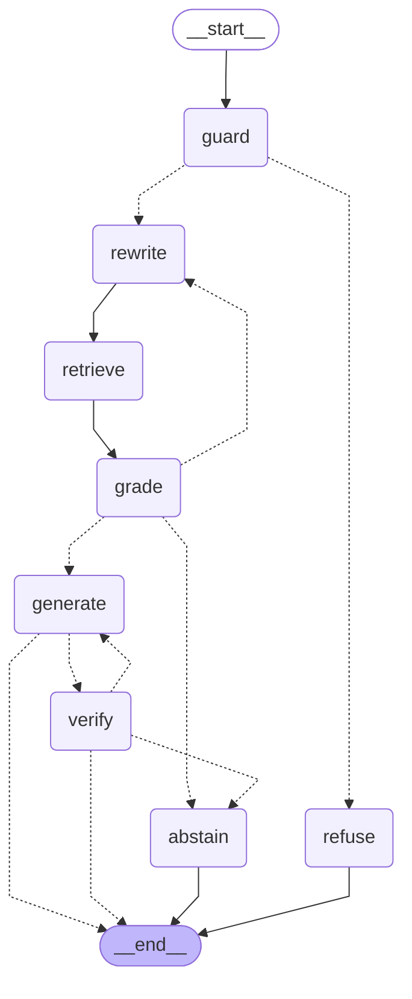

# Macro agent graph (LangGraph)

Generated from the compiled graph in `src/wealthai/agent/macro.py` with `graph.get_graph().draw_mermaid()`.
Dotted edges are conditional. Same loop as the [KID agent](agent_graph.md) (rewrite, retrieve, grade, generate, verify)
with its own vocabulary map, grading rules and retrieval over the SNB publications (`retrieval_macro.py`).

