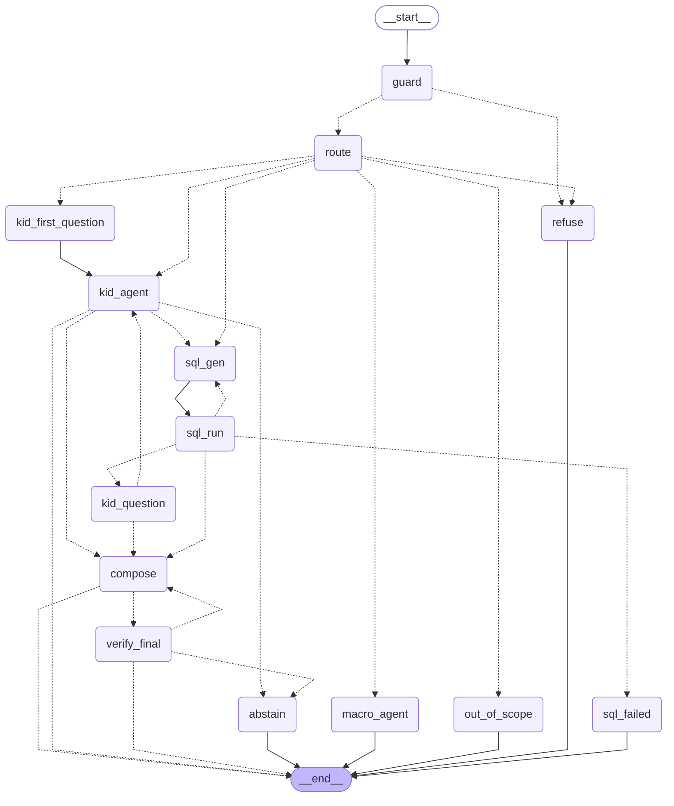

# Multi-source agent graph (LangGraph)

Generated from the compiled graph in `src/wealthai/agent/multi.py` with `graph.get_graph().draw_mermaid()`.
Dotted edges are conditional. The `kid_agent` node runs the separate KID agent described in
[agent_graph.md](agent_graph.md); the `macro_agent` node runs the macro agent described in
[macro_agent_graph.md](macro_agent_graph.md).

